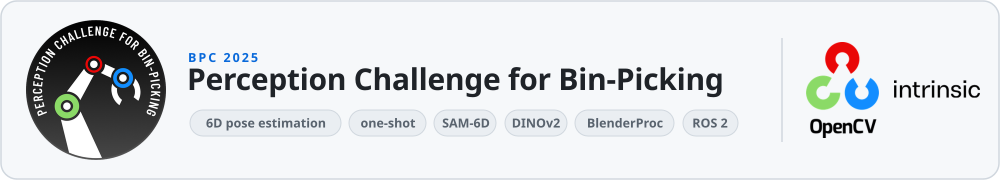
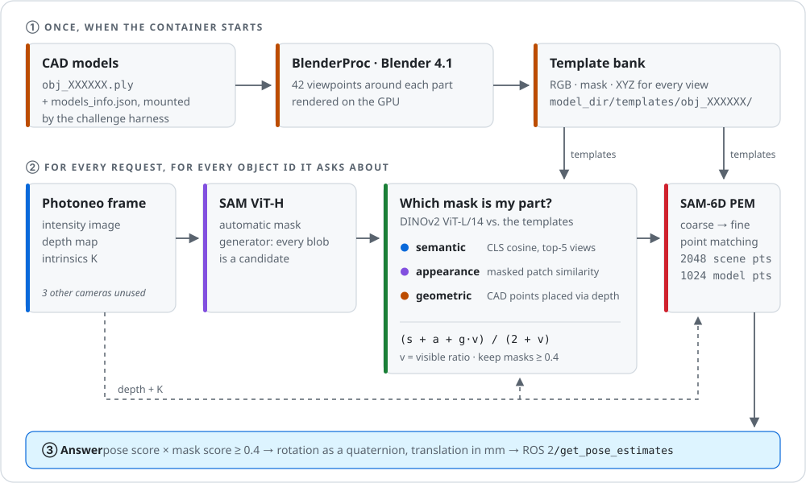

<picture>
  <source media="(prefers-color-scheme: dark)" srcset="docs/assets/hero-dark.svg">
  
</picture>

<p align="center">
  <a href="https://opencv.org/announcing-the-winners-of-the-first-perception-challenge-for-bin-picking-bpc/"></a>
  <a href="https://opencv.org/announcing-the-winners-of-the-first-perception-challenge-for-bin-picking-bpc/"></a>
  <a href="https://opencv.org/announcing-the-winners-of-the-first-perception-challenge-for-bin-picking-bpc/"></a>
</p>

<p align="center">
  <a href="#how-it-works"><b>How it works</b></a> &nbsp;·&nbsp;
  <a href="docs/APPROACH.md"><b>Technical notes</b></a> &nbsp;·&nbsp;
  <a href="docs/RUNNING.md"><b>Run it</b></a> &nbsp;·&nbsp;
  <a href="https://opencv.org/announcing-the-winners-of-the-first-perception-challenge-for-bin-picking-bpc/"><b>Winners announcement</b></a>
</p>

> [!NOTE]
> You're on the **`oneshot`** branch: the work that came *after* the scored testing-phase submission on [`main`](../../tree/main). It runs pose inference in batches of 12, counts out-of-memory and other errors, and uses lower thresholds (0.35 for masks, 0.3 for poses) than the 0.4 / 0.4 described below. See [what changed](docs/APPROACH.md#the-oneshot-branch).

---

The **[Perception Challenge for Bin-Picking (BPC)](https://bpc.opencv.org/)** was organized in 2025 by OpenCV, Intrinsic, BOP and the University of Hawaiʻi at Mānoa to benchmark **6DoF object pose estimation** in realistic industrial bin-picking scenes. Given a bin of cluttered, partially occluded parts, a solution must report where each requested part is and how it is oriented.

Participants were provided with CAD models of the target parts and the multi-view, multimodal [Industrial Plenoptic Dataset (IPD)](https://huggingface.co/datasets/bop-benchmark/ipd): RGB, depth and polarization from three cameras, plus a Photoneo structured-light sensor. Solutions were submitted as Docker containers, queried through a ROS 2 service, and scored by mAP over MSSD thresholds from 2 to 20 mm. More than 450 teams registered.

I competed as **`bpc_participant_oneshot`** and finished **5th overall** and **2nd among one-shot solutions**, winning a **$3,000** prize 🏆.

This repository is the organizers' [starter kit](https://github.com/opencv/bpc) with **one commit on top**: my pipeline.

## 🎯 The one-shot catch

The one-shot track came with a single rule that shapes everything else: **the model can't be trained on the challenge parts.** It gets each part's CAD file and nothing more.

For the final testing phase, the organizers swapped in **ten parts nobody had seen**, and allowed only a few submissions. The submission also had to run on one NVIDIA L4 (24 GB) and get through the whole test set within 12 hours. So in this pipeline, everything specific to a part is derived *inside the container*, *at runtime*, from the CAD meshes the challenge harness mounts. On that hidden test set it scored **0.207 mAP**, 5th overall on the testing leaderboard.

<a id="how-it-works"></a>

## ⚙️ How it works

<p align="center">
<picture>
  <source media="(prefers-color-scheme: dark)" srcset="docs/assets/pipeline-dark.svg">
  
</picture>
</p>

The method is **[SAM-6D](https://github.com/JiehongLin/SAM-6D)** (CVPR 2024). The work in this repo was turning it into something that survives a competition harness.

1. **Learn the parts when the container starts.** BlenderProc renders every CAD model the harness provides from 42 viewpoints. For each view it saves a color image, a mask, and the 3D object coordinates of every pixel. That's the entire "training" step.
2. **Propose everything.** For each request, SAM (ViT-H) splits the Photoneo image into every region it can find. At this point it has no idea which region, if any, is the part being asked about.
3. **Pick the right masks.** DINOv2 compares each proposal with the rendered templates in three ways:
   - **semantic:** does it look like the part overall?
   - **appearance:** do the local patches match the best view?
   - **geometric:** if the CAD model is placed at the proposal's depth, does its silhouette line up with the mask?

   The scores are blended, weighted by how much of the part is visible. Proposals below 0.4 are dropped.
4. **Recover the pose.** SAM-6D's Pose Estimation Model lifts each surviving mask into a point cloud, matches it against points from the templates (coarse first, then fine), and solves for rotation and translation. The pose confidence is multiplied by the mask score, and anything under 0.4 is cut. What remains goes back over ROS 2 as quaternions and millimeters.

The [technical notes](docs/APPROACH.md) cover the details: thresholds, coordinate conventions, and where the GPU memory went.

## 🛠️ What I built, and what I borrowed

I didn't invent the networks. SAM, DINOv2 and SAM-6D's pose model are other people's excellent research, used with their pretrained weights. My work was the engineering that made them a competitive, self-contained entry:

| Piece | What I did |
| --- | --- |
| **One process, no disk round-trips** | SAM-6D ships as separate scripts that talk through files. I rewrote both stages as classes ([`ISM`](ibpc_pose_estimator_py/ibpc_pose_estimator_py/Instance_Segmentation_Model/run_inference_custom.py), [`PEM`](ibpc_pose_estimator_py/ibpc_pose_estimator_py/Pose_Estimation_Model/run_inference_custom.py)). They load once when the [ROS node](ibpc_pose_estimator_py/ibpc_pose_estimator_py/ibpc_pose_estimator.py) starts, and masks pass between them in memory as RLE. |
| **Templates on demand** | [`Render/`](ibpc_pose_estimator_py/ibpc_pose_estimator_py/Render) renders templates for whatever parts the harness mounts, so the same image works on parts it has never seen. This is what makes it genuinely one-shot. |
| **Fitting on one GPU** | SAM ViT-H, DINOv2 ViT-L and the pose model share a single card. The per-mask depth math runs on the CPU in chunks of eight. Tensors are freed between stages, everything runs under `no_grad`, SAM and DINOv2 use autocast, and PyTorch's allocator uses expandable segments. |
| **Thresholds** | The mask and pose score cut-offs were adjusted across submissions. Too low and false positives eat into mAP; too high and real parts disappear. |

## 🚀 Run it

You'll need Linux, Docker with the NVIDIA Container Toolkit, an NVIDIA GPU (the target was a 24 GB L4), the pretrained checkpoints, and a Blender 4.1 build. The [full guide](docs/RUNNING.md) covers each one. In short:

```bash
cd ibpc_py && pip install . && cd ..        # the organizers' `bpc` CLI
bpc fetch ipd                               # IPD validation data + CAD models
docker build -f Dockerfile.estimator -t bpc-sam6d .
bpc test bpc-sam6d ipd                      # writes submission.csv
```

## 🌿 Branches

| Branch | What's in it |
| --- | --- |
| **`main`** | The code behind the testing-phase submission: the version that earned the placing. |
| **`oneshot`** | One more commit with what came after: pose inference in batches of 12, out-of-memory and error counters, thresholds of 0.35 and 0.3, stable ROS 2 apt sources, and FastSAM updated for newer `ultralytics`. |

## 🗺️ Repository map

```text
ibpc_pose_estimator_py/ibpc_pose_estimator_py/
├── ibpc_pose_estimator.py         ROS 2 node: loads models, answers /get_pose_estimates
├── Instance_Segmentation_Model/   SAM + DINOv2 proposal matching (my run_inference_custom.py)
├── Pose_Estimation_Model/         SAM-6D pose model + PointNet2 ops (my run_inference_custom.py)
└── Render/                        startup template rendering with BlenderProc
models/                            checkpoints go here (not in Git), see models/README.md
docs/                              technical notes, run guide, figures
Dockerfile.estimator               CUDA, PyTorch, PointNet2 and the ROS 2 overlay
ibpc_interfaces/                   the organizers' service definition
ibpc_tester/  ibpc_py/             the organizers' tester and `bpc` CLI
```

For the challenge's own setup and submission instructions, see the [organizers' original README](https://github.com/opencv/bpc/blob/9a5cc27/README.md).

## 🙏 Thanks

To **OpenCV**, **Intrinsic**, **BOP** and the **University of Hawaiʻi at Mānoa** for building the challenge, the [IPD dataset](https://huggingface.co/datasets/bop-benchmark/ipd) and the harness this repo started from.

To Jiehong Lin, Lihua Liu, Dekun Lu and Kui Jia for **[SAM-6D](https://arxiv.org/abs/2311.15707)**, the method this entry is built on. Thanks too to the teams behind [CNOS](https://github.com/nv-nguyen/cnos), [Segment Anything](https://github.com/facebookresearch/segment-anything), [DINOv2](https://github.com/facebookresearch/dinov2) and [BlenderProc](https://github.com/DLR-RM/BlenderProc).

The starter kit's [Apache 2.0 license](LICENSE) is kept. Vendored SAM-6D code and all pretrained weights remain under their original authors' terms.
